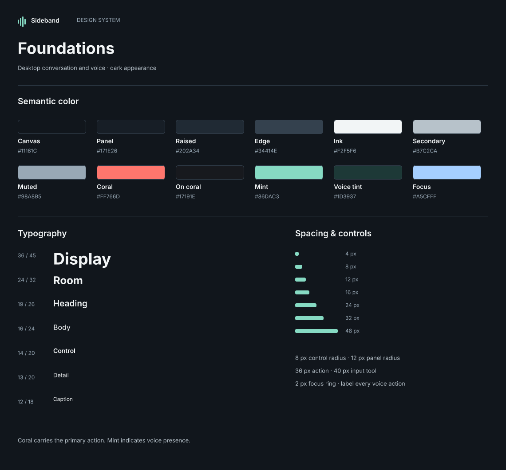

# Sideband desktop design system

## Overview

This is the design baseline for upcoming desktop work. The editable source is the **Design system** page in FigCraft. Its **Foundations**, **Component library**, and **Onboarding forms** boards define the values and states used in the prototypes. The YAML above mirrors the `Sideband` variable collection and the seven text styles. The other variable collections drive the prototype scenarios. [Open the FigCraft workspace](docs/design/Sideband%20workspace.figcraft) · [Prototype walkthroughs and export instructions](docs/design/README.md)

## Colors

| Role | Tokens | Use |
|---|---|---|
| Surfaces | Canvas, Rail, Panel, Raised, Hover, Edge | Canvas carries history. Rail holds server identities. Panel groups navigation, menus and sheets. Raised gives controls a surface. Hover highlights a row. Edge separates adjacent surfaces. |
| Reading | Ink, Secondary, Muted | Use Ink for messages and active labels, Secondary for names and supporting text, and Muted for timestamps, placeholders and section labels. |
| Primary action | Coral, On coral | Pair a Coral surface with On coral text and icons for Send, Join voice and the primary onboarding action. |
| Voice and connection | Mint, Voice tint | Use Mint for connection indicators and room occupancy. Pair it with Voice tint for a toggled call control. Name the state in text, such as **In voice** or **Unmute**. |
| Errors and leaving | Alert, Rose tint | Use Alert for an invalid field and its explanation. Pair Alert with Rose tint for **Leave voice**. |
| Keyboard focus | Focus | Use a visible 2 px ring. Keep the indicator visible at panel and window edges. |
| People | Avatar clay, sage, lilac and sand | Set dark initials on a tinted circle. Represent presence with a separate indicator. |

Use the production offset-bands mark for the Sideband logo and application icon. The brand guide records the vector master and its own palette. [Sideband identity assets](apps/desktop/public/brand/README.md)

## Typography

Use Inter throughout the workspace. **Display** introduces a flow, **Room** names the current destination, and **Heading** groups content within it. **Body** is the message style. Its larger size and stronger color give what someone said priority over their name and timestamp. Use **Control** for button and field labels, **Detail** for help and descriptions, and **Caption** for timestamps and short status labels.

## Layout

At **1440 × 900**, the conversation prototype has a 64 px server rail and a 240 px channel sidebar. The conversation takes the remaining width. Search and Members share a header. Personal settings stays available at the bottom of the sidebar.

At **760 × 600**, navigation moves behind a header button. Search, Members and Settings remain reachable. The bottom of the window stacks the reply context, composer and active call dock in normal flow. The dock takes the height of its content and collapses on leaving voice. With a short reply draft and an active call, two short messages, Send and every call control should fit together. These sizes are reference windows for review. [Compact call and reply preview](docs/design/compact-call-preview.png)

## Shapes

Use the control radius on buttons, fields and selected rows. Use the panel radius on the composer and settings sheets. Circular initials identify people, while server tiles use rounded squares. Standard desktop actions are 36 px high, composer icon tools occupy 40 × 40 px, and onboarding fields and actions are 42 px high.

## Components

| Pattern | Behavior to preserve |
|---|---|
| Channel and voice rows | A hash identifies text. A speaker and count identify a voice room. Selecting a room previews its people and saved microphone mode. Only **Join voice** starts the call. |
| Composer and message actions | Start with one line, keep Attach and Send available, and disclose formatting on demand. **Reply** is directly accessible on hover or keyboard focus. **More** holds secondary actions. Enter sends, Shift+Enter inserts a line, and a failed send retains the draft. |
| Call dock | Keep the active room, Mute, Deafen, Audio and Leave voice available across channel changes. Update labels to **Unmute** and **Undeafen** as appropriate. Muted guidance takes precedence over the saved talking mode. |
| Personal settings and server menu | Settings and the dock's Audio shortcut lead to the same personal audio surface. Put input, output, talking mode and mic check first. Show server administration according to permission. **Disconnect from server** lives in the server menu. |
| Onboarding fields | Use persistent labels and the empty, filled, focused and invalid field states. Explain a validation error beside its field and focus the first invalid input on submit. Show the invite field only when the server requires one. Chat is available before microphone setup. |
| Menus and sheets | Keep keyboard order aligned with reading order. Escape dismisses the surface and returns focus to its opener. Opening members or audio settings preserves the current channel and draft. |

For an implementation review, exercise an empty composer, a draft and an active reply at both reference sizes, with and without a call. For onboarding, follow the address-to-first-message flow and the trust or recovery path affected by the change. The **Interaction plan** page records the acceptance checks. [Design walkthroughs](docs/design/README.md)
