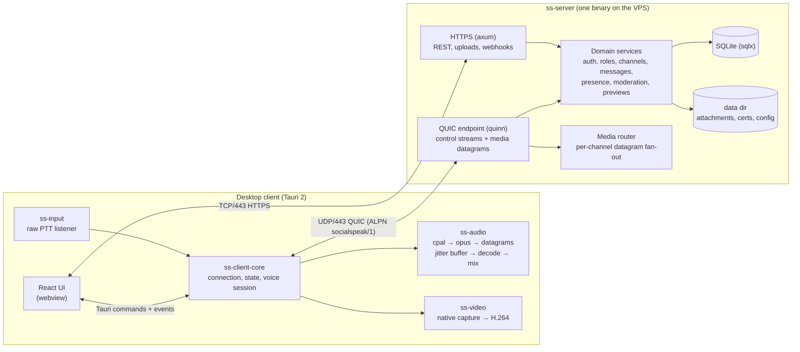

# Architecture

## System view



## Cargo workspace

```
socialspeak/
├── Cargo.toml                 # workspace, shared lints, shared deps
├── rust-toolchain.toml
├── justfile                   # just check | test | run-server | run-cli | dev-desktop
├── crates/
│   ├── ss-core/               # ids, permissions bitflags, errors, config types, time
│   ├── ss-proto/              # .proto files + prost codegen, framing, version negotiation
│   ├── ss-net/                # quinn setup, TLS/TOFU, control stream codec, datagram header, track model
│   ├── ss-audio/              # device I/O, resampling, opus wrapper, jitter buffer, mixer, processing chain
│   ├── ss-input/              # global raw input listener (PTT) per OS
│   ├── ss-video/              # native screen/window capture, scale, H.264 encode
│   ├── ss-client-core/        # headless client: connection manager, state store, voice session, events
│   ├── ss-cli/                # headless test client (spike, load tests, diagnostics)
│   └── ss-server/             # the server binary
├── apps/
│   └── desktop/               # Tauri 2 app
│       ├── src-tauri/         # Rust shell: commands/events bridging ss-client-core
│       └── src/               # React + TypeScript + Vite + Tailwind
├── deploy/                    # Dockerfile, docker-compose.yml, systemd unit, example config
└── docs/plan/                 # this plan
```

Dependency direction (no cycles): `ss-core` ← `ss-proto` ← `ss-net` ←
`ss-client-core` ← (`ss-cli`, `apps/desktop`); `ss-audio` and `ss-input` depend
only on `ss-core`; `ss-video` is transport-independent and optionally feeds
`ss-client-core`; `ss-server` depends on `ss-core`, `ss-proto`, `ss-net`.

## Server runtime model

- `tokio` multi-threaded runtime. The endpoint accept loop dispatches pending
  handshakes into bounded per-peer tasks; it never waits for one peer's
  handshake before accepting the next. One task per established QUIC
  connection owns its control stream; a shared `ServerState` is behind `Arc`.
- **Connection registry**: `user_id → ConnectionHandle` (a `quinn::Connection`
  clone plus an mpsc sender for outbound control messages). A user may have
  several connections (desktop + laptop); voice is per connection.
- **Voice registry**: `channel_id → Vec<VoiceMember { conn_id, user_id, track_ids, deaf, server_mute }>`.
  Stored in a `parking_lot::RwLock<HashMap>`; read-heavy on the datagram path.
- **Media router**: on datagram receive, parse the 8–10 byte header, look up
  the sender's voice channel, and call `send_datagram` on every other member's
  connection that isn't deafened. No decode, no copy beyond the slice. Drops
  on a full send buffer are counted, never awaited.
- **Domain services** are plain structs with `async fn`s over a `sqlx::SqlitePool`
  (WAL mode, `synchronous=NORMAL`, single writer via a connection pool of
  size 1 for writes plus a read pool).
- **Event fan-out**: domain mutations produce `ServerEvent`s published to a
  `tokio::sync::broadcast` channel; each connection task filters by
  permission/visibility and forwards to its control stream, waiting for room
  in its own bounded queue. Each command runs on its own task so the session
  keeps draining the bus meanwhile. A session that falls behind the bus, or
  whose queue for frames addressed to it by other tasks fills, is closed and
  resyncs from `Welcome`; no frame is dropped on an open connection. DM
  channel events are applied from the event by that DM's members only; role,
  override and guild channel changes trigger a debounced diff of the guild
  channel view, and one command publishes one such trigger however many
  channels it changed.
- **HTTP** (`axum`) shares `ServerState`; used only for things that are
  awkward over the control stream: history pagination, uploads/downloads,
  webhooks, server info, avatars.
- **Single data dir** (`--data-dir`): `config.toml`, `socialspeak.db`,
  `attachments/`, `tls/`, `logs/`.

## Client runtime model

- `ss-client-core` is runtime-agnostic Rust usable from Tauri commands and the
  CLI. It owns: `ConnectionManager` (connect, auth, reconnect with backoff,
  session resume), `StateStore` (server tree, members, voice states, message
  cache per channel, read states), `VoiceSession` (owns the audio graph while
  joined to a voice channel), and an outbound `broadcast` of `ClientEvent`s
  the UI subscribes to.
- Each live QUIC connection has two tasks. The **media pump** owns datagram
  send and receive and the transport stats. It stamps each inbound datagram
  as it is read and is never blocked by the control stream. It starts once
  the connection may carry voice (at connect, and on resume right after the
  voice seat is restored) and ends with the connection. The **connection
  loop** selects over events, the heartbeat, one in-flight command and the
  message resync. Commands still run one at a time and in order, but the
  pending Ack is just another branch, so events and the heartbeat keep
  running while it waits.
- The heartbeat compares `Instant` with the wall clock once a second. On
  macOS `Instant` stops while the machine sleeps, so a wall-clock jump of more
  than 3 s reconnects with the resume token.
- On resume the client installs the snapshot, rejoins voice and replays
  queued sends, then reports `Connected`. The cached history is then re-read
  over HTTPS, newest page first (one pinned client for the whole run), on a
  separate task, so messages, edits and deletes from while it was offline all
  show (`02-protocol.md` §1.2). The connection loop merges each page between
  live events, and a live edit or delete wins over the older copy in a page.
- Datagram send buffers are small because quinn drops the oldest queued
  datagram only when the buffer is full: 3 KiB on the client (about
  100–250 ms of one sender's audio, depending on profile) and 16 KiB on the
  server, which carries every speaker to each member. Receive buffers stay
  at 4 MiB.
- With its optional `screen-share` feature, `ss-client-core` owns a pull-driven
  `ScreenShareSession`: `ss-video` captures/scales/encodes and the session maps
  each IDR-led GOP onto the T-070 QUIC stream transport.
- Tauri shell exposes a thin command surface (`connect`, `join_voice`,
  `send_message`, …) and forwards `ClientEvent`s as Tauri events. No business
  logic in `src-tauri` beyond marshalling.
- The React UI holds a mirror of `StateStore` (Zustand) fed by events, and
  calls commands. It never talks to the network: history, attachments and
  previews are Rust commands, so the pinned certificate and bearer token
  stay in Rust.

## Audio graph (client, per voice session)

```
capture device (cpal, 48k preferred)
  → resample to 48k mono/stereo (rubato, only if device rate ≠ 48k)
  → optional processing chain [AEC → NS → AGC] (off by default)
  → gate (PTT state | VAD)
  → Opus encoder (profile from channel settings)
  → datagram header + send

datagram receive
  → demux by track_id → per-track JitterBuffer (adaptive, NetEQ-style)
  → per-track Opus decoder (Deep PLC on loss)
  → per-user gain → mixer (f32, soft limiter)
  → local UI sounds mixed in (join/leave/mention)
  → resample to device rate if needed → playback device (cpal)
```

The real-time callbacks never allocate, lock, or log. Communication with the
rest of the app is through lock-free SPSC ring buffers (`rtrb`) and atomics.
Profile numbers, the processing chain, and the jitter target are in
[`docs/design/voice.md`](../design/voice.md).

## Security model (summary)

- Transport: TLS 1.3 via QUIC and HTTPS. Public-certificate servers use hostname/CA
  validation with automatic renewal; self-signed servers require explicit leaf
  pin approval. Legacy pins remain strict until explicitly migrated. See
  `docs/security.md` for the trust policy and reverse-proxy boundary.
- Auth: argon2id password hashes; opaque session tokens (random 32 bytes,
  stored hashed); invite-only registration; the first account is the owner.
- Authorization: every mutating command runs through `Permissions::check`
  (see `03-data-model.md`), tested by table-driven unit tests.
- Media is only forwarded to members of the same voice channel with
  `connect`; speaking requires `speak`; server mute blocks forwarding at the
  router.
- Uploads: size limits, content sniffing, served with `Content-Disposition:
  attachment` for non-image types, never executed.
- Link previews: fetched server-side with SSRF guards (deny private, loopback,
  link-local, and multicast ranges after DNS resolution; 5 s timeout; 1 MiB cap;
  no redirects into denied ranges).
