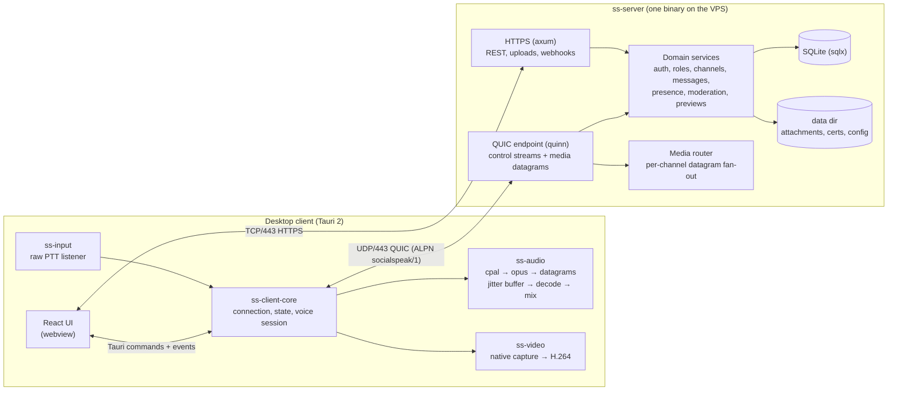

# Architecture

## System view



## Cargo workspace

```
socialspeak/
├── Cargo.toml                 # workspace, shared lints, shared deps
├── rust-toolchain.toml
├── justfile                   # just check | test | run-server | run-cli | dev-desktop
├── crates/
│   ├── ss-core/               # ids, permissions bitflags, errors, config types, time
│   ├── ss-proto/              # .proto files + prost codegen, framing, version negotiation
│   ├── ss-net/                # quinn setup, TLS/TOFU, control stream codec, datagram header, track model
│   ├── ss-audio/              # device I/O, resampling, opus wrapper, jitter buffer, mixer, processing chain
│   ├── ss-input/              # global raw input listener (PTT) per OS
│   ├── ss-video/              # native screen/window capture, scale, H.264 encode
│   ├── ss-client-core/        # headless client: connection manager, state store, voice session, events
│   ├── ss-cli/                # headless test client (spike, load tests, diagnostics)
│   └── ss-server/             # the server binary
├── apps/
│   └── desktop/               # Tauri 2 app
│       ├── src-tauri/         # Rust shell: commands/events bridging ss-client-core
│       └── src/               # React + TypeScript + Vite + Tailwind
├── deploy/                    # Dockerfile, docker-compose.yml, systemd unit, example config
└── docs/plan/                 # this plan
```

Dependency direction (no cycles): `ss-core` ← `ss-proto` ← `ss-net` ←
`ss-client-core` ← (`ss-cli`, `apps/desktop`); `ss-audio` and `ss-input` depend
only on `ss-core`; `ss-video` is transport-independent and optionally feeds
`ss-client-core`; `ss-server` depends on `ss-core`, `ss-proto`, `ss-net`.

## Server runtime model

- `tokio` multi-threaded runtime. The endpoint accept loop dispatches pending
  handshakes into bounded per-peer tasks; it never waits for one peer's
  handshake before accepting the next. One task per established QUIC
  connection owns its control stream; a shared `ServerState` is behind `Arc`.
- **Connection registry**: `user_id → ConnectionHandle` (a `quinn::Connection`
  clone plus an mpsc sender for outbound control messages). A user may have
  several connections (desktop + laptop); voice is per connection.
- **Voice registry**: `channel_id → Vec<VoiceMember { conn_id, user_id, track_ids, deaf, server_mute }>`.
  Stored in a `parking_lot::RwLock<HashMap>`; read-heavy on the datagram path.
- **Media router**: on datagram receive, parse the 8–10 byte header, look up
  the sender's voice channel, and call `send_datagram` on every other member's
  connection that isn't deafened. No decode, no copy beyond the slice. Drops
  on a full send buffer are counted, never awaited.
- **Domain services** are plain structs with `async fn`s over a `sqlx::SqlitePool`
  (WAL mode, `synchronous=NORMAL`, single writer via a connection pool of
  size 1 for writes plus a read pool).
- **Event fan-out**: domain mutations produce `ServerEvent`s published to a
  `tokio::sync::broadcast` channel; each connection task filters by
  permission/visibility and forwards to its control stream.
- **HTTP** (`axum`) shares `ServerState`; used only for things that are
  awkward over the control stream: history pagination, uploads/downloads,
  webhooks, server info, avatars.
- **Single data dir** (`--data-dir`): `config.toml`, `socialspeak.db`,
  `attachments/`, `tls/`, `logs/`.

## Client runtime model

- `ss-client-core` is runtime-agnostic Rust usable from Tauri commands and the
  CLI. It owns: `ConnectionManager` (connect, auth, reconnect with backoff,
  session resume), `StateStore` (server tree, members, voice states, message
  cache per channel, read states), `VoiceSession` (owns the audio graph while
  joined to a voice channel), and an outbound `broadcast` of `ClientEvent`s
  the UI subscribes to.
- With its optional `screen-share` feature, `ss-client-core` owns a pull-driven
  `ScreenShareSession`: `ss-video` captures/scales/encodes and the session maps
  each IDR-led GOP onto the T-070 QUIC stream transport.
- Tauri shell exposes a thin command surface (`connect`, `join_voice`,
  `send_message`, …) and forwards `ClientEvent`s as Tauri events. No business
  logic in `src-tauri` beyond marshalling.
- The React UI holds a mirror of `StateStore` (Zustand) fed by events, and
  calls commands. It never talks to the network directly except HTTPS for
  attachments through a Tauri-provided fetch (so the pinned cert is honored).

## Audio graph (client, per voice session)

```
capture device (cpal, 48k preferred)
  → resample to 48k mono/stereo (rubato, only if device rate ≠ 48k)
  → optional processing chain [AEC → NS → AGC] (off by default)
  → gate (PTT state | VAD)
  → Opus encoder (profile from channel settings)
  → datagram header + send

datagram receive
  → demux by track_id → per-track JitterBuffer (adaptive, NetEQ-style)
  → per-track Opus decoder (Deep PLC on loss)
  → per-user gain → mixer (f32, soft limiter)
  → local UI sounds mixed in (join/leave/mention)
  → resample to device rate if needed → playback device (cpal)
```

The real-time callbacks never allocate, lock, or log. Communication with the
rest of the app is through lock-free SPSC ring buffers (`rtrb`) and atomics.
Profile numbers, the processing chain, and the jitter target are in
[`docs/design/voice.md`](../design/voice.md).

## Security model (summary)

- Transport: TLS 1.3 via QUIC and HTTPS. Public-certificate servers use hostname/CA
  validation with automatic renewal; self-signed servers require explicit leaf
  pin approval. Legacy pins remain strict until explicitly migrated. See
  `docs/security.md` for the trust policy and reverse-proxy boundary.
- Auth: argon2id password hashes; opaque session tokens (random 32 bytes,
  stored hashed); invite-only registration; the first account is the owner.
- Authorization: every mutating command runs through `Permissions::check`
  (see `03-data-model.md`), tested by table-driven unit tests.
- Media is only forwarded to members of the same voice channel with
  `connect`; speaking requires `speak`; server mute blocks forwarding at the
  router.
- Uploads: size limits, content sniffing, served with `Content-Disposition:
  attachment` for non-image types, never executed.
- Link previews: fetched server-side with SSRF guards (deny private, loopback,
  link-local, and multicast ranges after DNS resolution; 5 s timeout; 1 MiB cap;
  no redirects into denied ranges).
