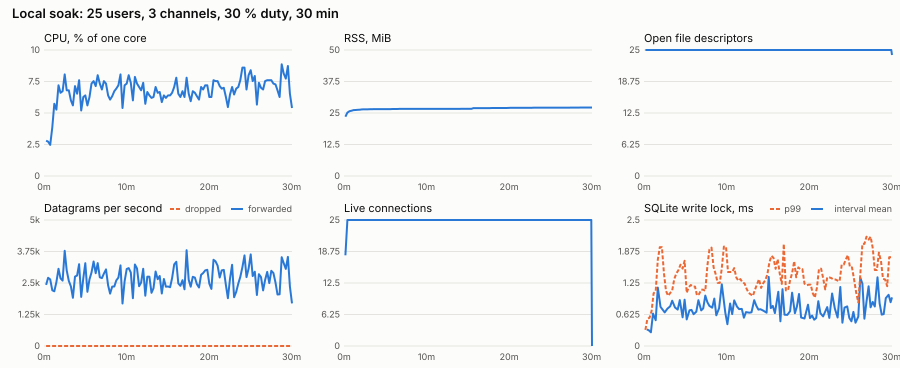
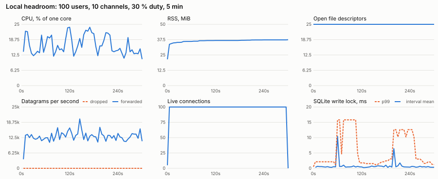
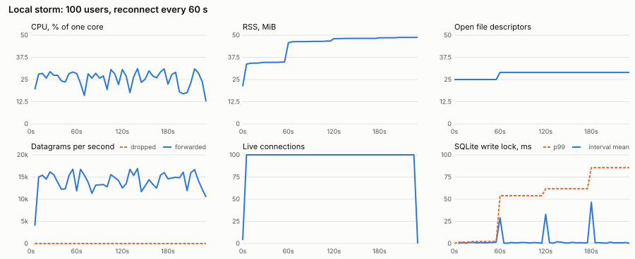

# Load and soak test (T-062)

Status: local runs done on a development Mac at reduced length. **The
full-length runs on the VPS are still owed** (see "To run on the VPS"). The
acceptance thresholds in the task file are judged on the VPS, not here.

## Method

- **Server:** release `ss-server run` (authenticated QUIC, SQLite, metrics on
  the internal listener). Default runtime: one tokio thread.
- **Load:** `ss-cli load` in one separate process. Each bot is a real account
  with a session token, joins voice channel `load-((i-1) mod M)+1`, and
  - talks in bursts of pre-encoded 80 kb/s `voice` Opus (one second of a
    440 Hz tone, encoded once). Burst and silence lengths are exponential;
    the mean burst is `--burst` and the share of time talking is `--duty`.
    Bursts carry `TALK_START`/`TALK_END`. About 200-byte payloads, 50 pps.
  - posts to `load-text` at `--text-rate` messages per minute (Poisson).
  - with `--churn S` leaves voice after an exponential time with mean S and
    rejoins after about `--away` seconds.
  - with `--storm-every S` drops its connection together with every other
    bot and reconnects with its token (Hello, Welcome, JoinVoice, track).
  - after a session it did not end (server close, idle timeout, reset) it
    counts a **forced disconnect**, logs the reason, and reconnects.
- **Client-side measures** (`ss-cli load` report lines, summary, `--csv`):
  - *relay delay*: each datagram's 32-bit timestamp is the sender's 48 kHz
    clock since the process start. Receivers in the same process subtract it
    from their own clock. This is bot → server → bot, so it includes the
    server's queueing, two loopback (or network) hops, and the bot
    process's own scheduling. Resolution 21 µs; histogram error about 6 %.
  - *gaps*: missing sequence numbers per track, a client-side loss count.
  - *text ack*: `SendMessage` to its `Ack`, the SQLite write as a user sees it.
  - *join* and *storm rejoin*: connect start (or storm signal) to seated with
    a track.
- **Server-side measures** (`scripts/load-metrics.py scrape`, every 5 s):
  `/metrics` (connections, voice members, datagrams received, forwarded,
  dropped, rejected, messages, sessions, slow-consumer disconnects, SQLite
  write-lock histogram) plus `ps` RSS and CPU time and `lsof` descriptors.
  *Drop %* is `dropped / (forwarded + dropped)`: the router found a
  recipient's Quinn datagram buffer full. *SQLite write latency* is
  `socialspeak_db_seconds`, which runs from asking for the single write
  connection to releasing it, so it includes queueing behind other writers.
- New server counters for this task: `socialspeak_datagrams_received_total`,
  `socialspeak_datagrams_rejected_total` (both already counted by the router,
  now exported), `socialspeak_sessions_total`, and
  `socialspeak_slow_disconnects_total` (every `CLOSE_SLOW`). None touch the
  datagram path beyond the existing relaxed atomics.

### Caveats of the local numbers

- Apple M4 Pro, 14 cores, 48 GB, macOS 27. Loopback only: no real network,
  no packet loss, no NIC. Bots and server share the machine.
- Three other workspaces were compiling during these runs (load average 8 on
  14 cores). CPU percentages are noisy; latency tails include scheduler
  delays from those builds.
- The bot process costs more CPU than the server (33 % of a core at 100
  users and 30 % duty, 80 % at 100 % duty); the server number is the
  server process alone.
- `netstat -s -p udp` "dropped due to full socket buffers" is host-wide. It
  stayed flat in every run except the 30-minute soak (+14), where server
  drops and bot sequence gaps were both zero, so those belong to other
  processes on the machine.

## Commands

```sh
cargo build --release -p ss-server -p ss-cli
ss-server init --data-dir ./load-data          # prints the owner invite
# config.toml: bind_quic / internal bind as needed, previews.enabled = false
ss-server run --data-dir ./load-data &
# Accounts once. The first bot takes the owner invite, creates load-1..load-10,
# load-text, and an unlimited invite; the rest register 5 per minute (about
# 20 minutes for 100). Tokens land in --state and are reused afterwards.
ss-cli load 127.0.0.1:443 --bots 100 --channels 10 --duration 5 \
  --invite OWNER_CODE --state load-state.txt --accept-pin

# One scenario = scrape + bots + graph + summary.
SS_PID=$(pgrep -n ss-server) scripts/load-run.sh runs soak25 -- \
  ss-cli load 127.0.0.1:443 --state load-state.txt \
  --bots 25 --channels 3 --duty 0.3 --burst 3 --text-rate 1 --churn 300 \
  --duration 1800 --interval 60
```

Local scenarios (same flags plus `--state`, `--pin-file`, `--interval`):

| Run | Flags | Length |
|---|---|---|
| soak25 | `--bots 25 --channels 3 --duty 0.3 --burst 3 --text-rate 1 --churn 300` | 12 min and 30 min |
| headroom100 | `--bots 100 --channels 10 --duty 0.3 --burst 3 --text-rate 1 --churn 300` | 5 min |
| stress100 | `--bots 100 --channels 10 --duty 1 --text-rate 1`, `SS_WORKER_THREADS` 1 and 4 | 2 min each |
| storm100 | `--bots 100 --channels 10 --duty 0.3 --text-rate 1 --storm-every 60` | 230 s, 3 storms |

## Results (local)

Server process only. Forwarded/s averages the whole scrape including ramp-up.
RSS "steady" is the first sample after a 2-minute warm-up.

| Run | Users | Length | CPU mean / max | RSS start → steady → end | Forwarded/s | Drops | Forced | Relay p50 / p99 / max | Text ack p50 / p99 | SQLite lock mean / max |
|---|---|---|---|---|---|---|---|---|---|---|
| soak25 | 25 | 12 min | 5.8 % / 9.6 % | 21.1 → 27.2 → 27.8 MiB (+2.1 %) | 2,689 | 0 | 0 | 0.35 / 5.6 / 45 ms | 0.96 / 41 ms | 1.1 / 63 ms |
| soak25-long | 25 | 30 min | 6.8 % / 9.4 % | 21.2 → 26.4 → 27.2 MiB (+3.1 %) | 2,697 | 0 | 0 | 0.57 / 2.3 / 18 ms | 1.5 / 3.8 ms | 0.7 / 4.7 ms |
| headroom100 | 100 | 5 min | 16.6 % / 23.8 % | 21.5 → 36.8 → 37.5 MiB (+1.8 %) | 13,011 | 0 | 0 | 0.38 / 3.3 / 82 ms | 1.3 / 16 ms | 0.7 / 88 ms |
| stress100, 1 thread | 100, all talking | 2 min | 33 % / 35 % | 21.3 → 36.8 → 36.8 MiB | 43,681 | 0 | 0 | 0.51 / 2.6 / 45 ms | 1.5 / 6.7 ms | 0.6 / 6.9 ms |
| stress100, 4 threads | 100, all talking | 2 min | 103 % / 109 % | 21.6 → 36.6 → 36.6 MiB | 43,691 | 0 | 0 | 0.64 / 2.6 / 8 ms | 0.9 / 4.1 ms | 0.3 / 3.5 ms |
| storm100 | 100 | 230 s | 25 % / 31 % | 21.2 → 34.5 → 48.8 MiB | 14,031 | 0 | 0 | 0.38 / 2.3 / 53 ms | 1.8 / 6.7 ms | 19.8 / 86 ms |

Every run: zero datagram drops, zero sequence gaps, zero rejected sends,
zero slow-consumer disconnects, every message acknowledged, descriptors flat
at 25 (29 after the first storm: two more read-pool connections, capped at
four).

Storms: all 100 bots were back in voice with a track 246 ms (p95) and
262 ms (max) after each of three storms; no connect failures.

### Graphs

25 users, 30 minutes:



100 users at 30 % duty, 5 minutes:



100 users, a reconnect storm every 60 s:



## Findings

**Bottleneck at 100 users: UDP send syscalls on the single runtime thread.**
A 5-second `sample` of the server during stress100 (45,000 forwarded
datagrams/s) found the runtime thread busy in about 880 of 3,290 samples:
about 60 % of those in the kernel's `sendmsg_x`, 10 % in `recvmsg_x`, and
1–2 % each in Quinn's packet building, ring's AES-GCM, and
`Forwarder::forward`. Linux sends through `sendmmsg`/GSO instead, so the VPS
profile may differ; confirm it there. Fan-out cost is one encrypted packet and one send per
recipient, so it grows with members × talkers per channel. On this machine
one thread sustains all 100 users talking at once at a third of a core,
which puts the single-thread ceiling near 130,000 forwarded datagrams/s
(roughly 300 simultaneous talkers in 10-person channels). Realistic 30 %
duty at 100 users is 13,000/s and 17 % of a core. Memory is not a limit
(37 MiB at 100 users). SQLite is not on the voice path.

**Leak watch.** RSS rises during the first two minutes (allocator and SQLite
page caches warming, ~6 MiB at 25 users, ~15 MiB at 100) and is then nearly
flat. In the 30-minute soak RSS stayed at 26.6 MiB from
minute 4 to minute 15, stepped up 0.4 MiB at minute 16, and gained 0.2 MiB
over the last 14 minutes (27.2 MiB at the end). A straight line through the
post-warm-up samples is 1.8 MiB/h, which would be about +13 % over two hours
and fail the 10 % bar; the shape is steps rather than a ramp, which fits
caches filling (757 messages were stored), but 30 minutes cannot rule a
slow leak out. Leak suspicion: low, open until the 2-hour run. If the VPS
soak keeps rising, profile allocations with `heaptrack` before tuning.
Each storm raised RSS by a decreasing amount
(+11.6, +1.6, +0.3 MiB): the high-water mark of briefly holding old and new
connections together, not a per-storm leak. Descriptors and the connection
gauge return to their baseline. No monotonic growth was found in the
counters that matter; the 2-hour VPS run decides it.

**SQLite.** Message inserts hold the write lock under 1 ms on average. Two
kinds of spikes: a 30–90 ms tail once early in a run (WAL growth and
checkpoint), and storms, where 100 `Hello`s each slide a session row and
queue for the single writer (mean 20 ms, max 86 ms including the wait).
Neither affects voice, and storm rejoin stays near a quarter second.

**Registration limit.** Password login and registration are limited to five
per minute per source address, so one load host registers 100 bots in about
20 minutes. `--state` keeps tokens; later runs use `SessionToken`, which is
not limited. Reconnect storms use tokens too.

## Tuning outcomes

- **Tokio workers:** keep the default single thread. `SS_WORKER_THREADS=4`
  forwarded the same 43,700 datagrams/s for 3.1× the CPU (103 % vs 33 %),
  with a slightly higher relay median (0.64 vs 0.51 ms) and a lower maximum.
  Cross-thread wake-ups and the shared membership lock cost more than the
  parallel sends save at this scale. The knob stays for VPS experiments.
- **UDP buffers:** no full-buffer drops locally (macOS default receive
  space 768 KiB). The server endpoint does not request a buffer size, so on
  Linux it keeps `net.core.rmem_default` (208 KiB); the `rmem_max` sysctl in
  `deploy/README.md` only raises a ceiling. Check `RcvbufErrors` on the VPS
  before and after each run; if it moves, raise `net.core.rmem_default` /
  `wmem_default` or set the socket buffers in `ss-net` (BACKLOG).
- **SQLite cache:** no change. The database is under 1 MiB after these runs,
  so it fits the default page cache; write time is dominated by lock
  queueing in storms, not by reads.

## To run on the VPS

Server on the VPS from the release binary (`deploy/README.md`), metrics on
`127.0.0.1:9101`. Run `ss-cli load` from a second machine in the same
region so the bots do not share the server's CPU, and run
`scripts/load-metrics.py scrape --pid $(pgrep -n ss-server)` on the VPS
(or `scripts/load-run.sh` there with `ss-cli` pointed at the public
address; the relay delay then includes two network paths). Record
`netstat -su` (`RcvbufErrors`, `SndbufErrors`) before and after each run,
`nproc`, and the provider's instance type.

| Scenario | Command flags | Length | Pass |
|---|---|---|---|
| Soak | `--bots 25 --channels 3 --duty 0.3 --burst 3 --text-rate 1 --churn 300 --duration 7200 --interval 60` | 2 h | RSS growth after a 5-minute warm-up ≤ 10 % (`summary --warmup 300`); zero forced disconnects (`forced=0`, `slow_disconnects=0`); drop % < 0.1; descriptors flat |
| Headroom | `--bots 100 --channels 10 --duty 0.3 --burst 3 --text-rate 1 --churn 300 --duration 900` | 15 min | Record CPU, RSS, drops, relay p99, SQLite lock; name the bottleneck (`perf top -p` or `perf record -g` for 30 s) |
| Stress | `--bots 100 --channels 10 --duty 1 --duration 300`, then again with `SS_WORKER_THREADS=2` | 5 min each | Record the forwarded/s ceiling per core; keep one thread unless two is cheaper on the VPS |
| Storm | `--bots 100 --channels 10 --duty 0.3 --storm-every 120 --duration 900` | 15 min | Every bot back in voice (`rejoins = 100 × storms`); zero forced disconnects; storm p95 recorded |

Commit the summaries and the soak and headroom SVGs next to this file and
replace the local table with the VPS numbers.
