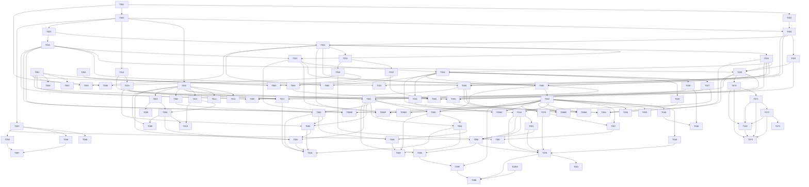

# Task index

Status values: `todo` · `in-progress` · `done` · `blocked`. Keep this table and
the `Status:` line in each task file in sync. Sizes: S / M / L (see
`00-overview.md`).

Current priority: [installable testing app](../05-testing-app.md).
T-075 packaging, essential T-043 onboarding, T-044 voice UI, T-051 audio settings
and T-058 global shortcuts are implemented; platform acceptance remains open.
T-076 guided testing and evidence export are implemented. Next: collect real
cross-OS acceptance reports with the installed app; T-018 remains the release gate.
While hands-on testing is deferred, software development continues. The T-045
text-chat increments are implemented. T-045A adds usable live conversations; T-045B implements
rich text/composer completion with hardware performance acceptance still open.
T-045C implements attachments and previews; cross-platform media acceptance remains open.
T-063 live diagnostics and operator inspection are implemented; real-call and
dashboard deployment acceptance remain open.
T-056A adds invite administration, T-056B adds filtered audit history and T-056C adds
webhook management. T-056D adds channel management; T-056E adds roles, member assignments
and channel permission overrides. T-056F adds server settings; T-056G completes member moderation.
T-057 implements signed update packaging and manual-only release feeds; installed
upgrade/signing acceptance remains open.
T-018 gates voice-quality release approval, not UI development or test builds.
Implemented prerequisites may feed this milestone while their documented
manual acceptance remains in progress; do not mark those tasks done early.

Review of 2026-11-09: T-081 to T-101 below record defects and plan drift
found by a full read of the code. Do the voice-path tasks T-081 to T-085
before collecting listening or PTT acceptance evidence, since the defects
they fix would be scored as voice quality. T-018 now depends on T-081 to
T-084, and T-074 on the backend decision in T-100.

## Phase 0 — Foundations

| ID | Task | Size | Depends on | Status |
|---|---|---|---|---|
| [T-001](T-001-workspace-scaffolding.md) | Workspace scaffolding and CI | S | — | done |
| [T-002](T-002-protocol-schema.md) | Protocol schema v1 and `ss-proto` | M | T-001 | done |
| [T-003](T-003-core-types.md) | `ss-core`: ids, permissions, config, errors | S | T-001 | done |
| [T-004](T-004-quic-transport.md) | `ss-net`: QUIC, TLS/TOFU, control stream, datagram header | M | T-002, T-003 | done |

## Phase 1 — Voice spike

| ID | Task | Size | Depends on | Status |
|---|---|---|---|---|
| [T-010](T-010-audio-device-layer.md) | `ss-audio` device layer | M | T-003 | done |
| [T-011](T-011-audio-windows-verification.md) | Windows audio verification | S | T-010 | todo |
| [T-012](T-012-audio-linux-verification.md) | Linux audio verification | S | T-010 | todo |
| [T-013](T-013-audio-macos-verification.md) | macOS audio verification | S | T-010 | done |
| [T-014](T-014-opus-codec.md) | Opus codec wrapper | S | T-003 | done |
| [T-015](T-015-jitter-buffer-mixer.md) | Jitter buffer, decoders, mixer | M | T-014 | done |
| [T-016](T-016-minimal-forwarding-server.md) | Minimal forwarding server | S | T-004 | done |
| [T-017](T-017-headless-cli-client.md) | Headless CLI client + latency measurement | M | T-010, T-014, T-015, T-016 | done |
| [T-018](T-018-spike-evaluation.md) | Voice-quality release gate vs TS3, parameter lock | S | T-017, T-081, T-082, T-083, T-084 | todo |
| [T-019](T-019-audio-macos-acceptance.md) | macOS audio manual acceptance, timestamp correction | S | T-013, T-054 | todo |

## Phase 2 — Server core

| ID | Task | Size | Depends on | Status |
|---|---|---|---|---|
| [T-020](T-020-database-schema.md) | SQLite schema, migrations, repositories | M | T-003 | done |
| [T-021](T-021-auth-sessions-invites.md) | Auth, sessions, invites, owner bootstrap | M | T-020, T-004 | done |
| [T-022](T-022-permissions-engine.md) | Permissions engine and roles | M | T-020 | done |
| [T-023](T-023-channel-management.md) | Channel tree management + snapshot | M | T-021, T-022 | done |
| [T-024](T-024-presence-registry-fanout.md) | Connection registry, presence, event fan-out | M | T-021 | done |
| [T-025](T-025-voice-membership-media-router.md) | Voice membership and media router | M | T-016, T-022, T-024 | done |
| [T-026](T-026-text-messaging.md) | Text messaging | M | T-023, T-024 | done |
| [T-027](T-027-attachments.md) | Attachments | M | T-026 | done |
| [T-028](T-028-direct-messages.md) | DMs and group DMs | S | T-026 | done |
| [T-029](T-029-link-previews.md) | Link previews (SSRF-safe) | M | T-026 | done |
| [T-030](T-030-moderation.md) | Moderation + audit log | M | T-022, T-024, T-025 | done |
| [T-031](T-031-incoming-webhooks.md) | Incoming webhooks | S | T-026 | done |
| [T-032](T-032-server-config-ops.md) | Config, CLI, tracing, metrics, shutdown | S | T-021 | done |
| [T-033](T-033-tls-modes.md) | TLS modes (self-signed, files, ACME) | S | T-004, T-032 | done |
| [T-034](T-034-deployment.md) | Deployment artifacts | S | T-032 | done |

## Phase 3 — Desktop client

| ID | Task | Size | Depends on | Status |
|---|---|---|---|---|
| [T-040](T-040-client-core-connection-state.md) | Client core: connection + state store | M | T-004, T-021, T-023, T-024, T-026 | done |
| [T-041](T-041-client-core-voice-session.md) | Client core: voice session | M | T-040, T-010, T-015, T-025 | done |
| [T-042](T-042-tauri-app-scaffold.md) | Tauri app scaffold and bridge | M | T-040 | done |
| [T-043](T-043-onboarding-ui.md) | Onboarding UI | M | T-042 | in-progress |
| [T-044](T-044-channel-voice-ui.md) | Channel sidebar and voice UI | M | T-042, T-041 | in-progress |
| [T-045](T-045-text-chat-ui.md) | Text chat UI (split into A–C) | L | T-042, T-027, T-029 | in-progress |
| [T-045A](T-045A-live-text-chat.md) | Live text chat foundation | M | T-042, T-026 | done |
| [T-045B](T-045B-rich-chat-composer.md) | Rich text and composer completion | M | T-045A | in-progress |
| [T-045C](T-045C-chat-attachments.md) | Chat attachments and previews | M | T-045A, T-027, T-029 | in-progress |
| [T-046](T-046-dm-ui.md) | DM UI | S | T-045A, T-028 | done |
| [T-047](T-047-input-core.md) | `ss-input` core API and PTT state machine | S | T-003 | done |
| [T-048](T-048-input-windows.md) | `ss-input` Windows backend | S | T-047 | in-progress |
| [T-049](T-049-input-macos.md) | `ss-input` macOS backend | S | T-047 | in-progress |
| [T-050](T-050-input-linux.md) | `ss-input` Linux backends | M | T-047 | in-progress |
| [T-051](T-051-audio-settings-ui.md) | Audio and voice settings UI | M | T-044, T-041, T-047 | in-progress |
| [T-052](T-052-voice-activation.md) | Voice activation detection | S | T-010, T-014 | done |
| [T-053](T-053-audio-processing-chain.md) | Optional processing chain (AEC/NS/AGC) | M | T-010 | done |
| [T-054](T-054-macos-voiceio-mode.md) | macOS AUVoiceIO mode | M | T-013, T-053 | done |
| [T-055](T-055-notifications-sounds.md) | Notifications and sound cues | S | T-042, T-041 | in-progress |
| [T-056](T-056-admin-ui.md) | Admin UI | M | T-042, T-030, T-023, T-031 | done |
| [T-056A](T-056A-invite-management.md) | Invite management UI and scoped history | S | T-042, T-030 | done |
| [T-056B](T-056B-audit-log.md) | Filterable audit-log viewer | S | T-042, T-030 | done |
| [T-056C](T-056C-webhook-management.md) | Webhook management UI and metadata history | S | T-042, T-031 | done |
| [T-056D](T-056D-channel-management.md) | Channel management UI | M | T-042, T-023 | done |
| [T-056E](T-056E-roles-permissions.md) | Roles, assignments and channel permissions UI | M | T-042, T-022, T-023 | done |
| [T-056F](T-056F-server-settings.md) | Server settings UI and persistent profile API | M | T-042, T-021, T-022, T-027 | done |
| [T-056G](T-056G-member-moderation.md) | Searchable members, timed bans and unban UI | M | T-042, T-030, T-056E | done |
| [T-057](T-057-packaging-updater.md) | Production packaging, signing, auto-update | M | T-042, T-075 | in-progress |
| [T-058](T-058-global-app-shortcuts.md) | Global shortcuts wiring in the app | S | T-047, T-044, T-051 | in-progress |
| [T-059](T-059-ml-noise-suppression.md) | ML noise suppression behind `deepfilter` | M | T-053 | blocked |
| [T-075](T-075-installable-test-builds.md) | Installable test builds and build identity — first priority | M | T-042 | in-progress |
| [T-076](T-076-guided-voice-testing.md) | Guided voice tests and local evidence bundles | M | T-075, T-043, T-044, T-051, T-058 | in-progress |

## Phase 4 — Hardening

| ID | Task | Size | Depends on | Status |
|---|---|---|---|---|
| [T-060](T-060-reconnect-resilience.md) | Session resume, migration, restart handling | M | T-040, T-041, T-024, T-025 | done |
| [T-061](T-061-security-review-fuzzing.md) | Security review, fuzzing, rate limits | M | T-021, T-022, T-026, T-027, T-029, T-030, T-031 | done |
| [T-062](T-062-load-soak-test.md) | Load and soak testing | S | T-017, T-025, T-026 | done |
| [T-063](T-063-diagnostics.md) | Diagnostics panel and server dashboards | S | T-041, T-044, T-032, T-076 | in-progress |
| [T-064](T-064-documentation.md) | Documentation | S | T-034, T-057 | todo |
| [T-065](T-065-message-search.md) | Message search (FTS5) | S | T-026, T-045 | done |
| [T-066](T-066-https-rest-listener.md) | Serve the public REST listener over TLS | M | T-033, T-061 | done |
| [T-067](T-067-security-acceptance.md) | Security acceptance: 1 h fuzz runs, doc review, licence policy | S | T-061 | todo |
| [T-068](T-068-server-hardening-followups.md) | Server hardening follow-ups (datagram cap, hashed invites, …) | M | T-061 | done |
| [T-069](T-069-vps-load-validation.md) | Load validation on the VPS, UDP buffer tuning | S | T-062, T-034 | todo |

## Phase 5 — Screen share

| ID | Task | Size | Depends on | Status |
|---|---|---|---|---|
| [T-070](T-070-video-track-transport.md) | Server: video tracks, subscriptions, keyframe relay | M | T-025, T-004 | done |
| [T-071](T-071-screen-capture-encode.md) | Client: capture + hardware encode | L | T-070, T-041 | in-progress |
| [T-072](T-072-stream-viewer.md) | Client: viewer (decode + wgpu window) | M | T-070, T-071 | in-progress |
| [T-073](T-073-screen-share-ui.md) | Screen share UI | S | T-071, T-072, T-044 | in-progress |
| [T-074](T-074-adaptive-bitrate.md) | Adaptive bitrate | M | T-070, T-071, T-072, T-100 | todo |

## Phase 6 — Bots

| ID | Task | Size | Depends on | Status |
|---|---|---|---|---|
| [T-080](T-080-bot-api.md) | Bot API | M | T-021, T-022, T-026, T-064 | todo |

## Review follow-ups — 2026-11-09

From a full review of the plan and the code at `d861a0a`. Findings were
traced by reading the code and not reproduced; each task starts by writing
the failing test. T-081 to T-088 are the voice path, T-089 and T-101 the
client transport, T-090 to T-094 the server, T-095 and T-096 the desktop
app, T-097 and T-098 release and deployment, T-099 the plan itself and
T-100 the open screen-share decision. Phase is in each task file.

| ID | Task | Size | Depends on | Status |
|---|---|---|---|---|
| [T-081](T-081-media-pump-independence.md) | Keep voice datagrams flowing while control commands are pending | M | T-041, T-060 | todo |
| [T-082](T-082-talk-burst-boundaries.md) | Correct talk-burst boundaries for voice activation and gate close | S | T-052, T-041 | todo |
| [T-083](T-083-playback-pacing-lag-recovery.md) | Bounded playback latency: ring-level pacing, jitter lag recovery | M | T-015, T-041, T-082 | todo |
| [T-084](T-084-device-reopen-retry.md) | Retry failed device reopens during a call | S | T-010, T-041, T-054, T-083 | todo |
| [T-085](T-085-mute-fail-closed-shortcuts.md) | Mute fails closed; global shortcuts are never dropped | M | T-041, T-058 | todo |
| [T-086](T-086-connection-identity-track-reuse.md) | Own connection id in Welcome; receivers survive track id reuse | M | T-081, T-082 | todo |
| [T-087](T-087-input-stuck-key-reconcile.md) | PTT cannot stick: XI 2.1 and physical-state reconcile | S | T-049, T-050 | todo |
| [T-088](T-088-capture-channel-voiceio-frames.md) | Capture channel selection and whole-frame ring transfers | S | T-010, T-054 | todo |
| [T-089](T-089-reconnect-policy.md) | Reconnect policy: retryable errors, address fallback, backoff, stale cache | M | T-060, T-081, T-086 | todo |
| [T-090](T-090-authorization-gaps.md) | Authorization gaps: overrides, role edits, voice seats, owner | M | T-022, T-025, T-030, T-061 | todo |
| [T-091](T-091-dm-welcome-fanout-limits.md) | Bound DMs, Welcome size and fan-out | M | T-028, T-024, T-061 | todo |
| [T-092](T-092-transfer-listener-limits.md) | Stream attachments, bound listeners, retire the spike default | M | T-027, T-033, T-066 | todo |
| [T-093](T-093-session-revocation.md) | Session revocation, logout and expiry | S | T-021, T-061 | todo |
| [T-094](T-094-server-event-correctness.md) | Member events, deleted content, cache races, media lock | M | T-024, T-025, T-026, T-029, T-091 | todo |
| [T-095](T-095-desktop-shell-hardening.md) | Desktop shell: capabilities, lints, locks, scaffold leftovers | M | T-042, T-085 | todo |
| [T-096](T-096-chat-history-notices-redaction.md) | Chat history robustness, user-visible notices, export redaction | M | T-045A, T-076, T-095 | todo |
| [T-097](T-097-release-pipeline-gating.md) | Gate releases: main only, tested commit, isolated signing, provenance | M | T-057, T-034 | todo |
| [T-098](T-098-deploy-ci-hygiene.md) | Deploy and CI hygiene: fail-closed checks, compose/NGINX limits, backups | M | T-034, T-001 | todo |
| [T-099](T-099-plan-doc-reconciliation.md) | Reconcile the plan with the code; acceptance status page | S | — | todo |
| [T-100](T-100-screen-share-backend-decision.md) | Decide the screen-share backend before adaptive bitrate | M | T-070, T-071, T-072 | todo |
| [T-101](T-101-router-tolerance-parser-fuzzing.md) | Router tolerates what the protocol allows; fuzz the real parsers | M | T-004, T-061 | todo |

Tasks that edit the same files are chained through "Depends on" so they do
not run at once: T-082 → T-083 → T-084 share the voice worker; T-081 →
T-086 → T-089 share the client connection; T-085 → T-095 → T-096 share the
shell command modules; T-091 → T-094 share the server connection loop.
T-090, T-091 and T-093 all touch `ss-server` permission and auth code;
run at most two of the server tasks at a time.

## Dependency graph

## Parallelization waves

What can run concurrently once its row's dependencies are done. Use this to
decide how many sub-agents to spawn.

| Wave | Tasks runnable in parallel |
|---|---|
| 1 | T-001 |
| 2 | T-002, T-003 |
| 3 | T-004, T-010, T-014, T-020, T-047 |
| 4 | T-016, T-015, T-011, T-012, T-013, T-021, T-022, T-048, T-049, T-050, T-052, T-053 |
| 5 | T-017, T-023, T-024, T-032, T-054, T-059 |
| 6 | T-019, T-025, T-026, T-033, T-034 |
| 7 | T-027, T-028, T-029, T-030, T-031, T-040, T-070 |
| 8 | T-041, T-042, T-062 |
| 9 | T-075 (priority), T-043, T-044, T-045, T-055, T-056, T-056A, T-056B, T-056C, T-056D, T-056E, T-056F, T-056G, T-060, T-069, T-071 |
| 10 | T-057, T-046, T-051, T-061, T-065, T-072 |
| 11 | T-058, T-064, T-066, T-067, T-068, T-073 |
| 12 | T-076, T-080 |
| 13 | T-063 |
| 14 | T-081, T-082, T-085, T-087, T-088, T-090, T-091, T-092, T-093, T-097, T-098, T-099, T-100, T-101 |
| 15 | T-083, T-086, T-094, T-095, T-074 |
| 16 | T-084, T-089, T-096 |
| 17 | T-018 |

Release gate: T-018 must record a "go" before voice quality is approved for
a stable/public release. UI work, packaging and labelled test builds proceed
now. If T-018 changes voice parameters, update `ss-core` defaults and
`02-protocol.md` §4 together. See the testing-app milestone for the current
delivery order; dependency waves do not override that priority.
