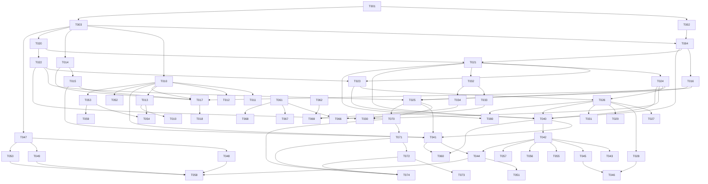

# Task index

Status values: `todo` · `in-progress` · `done` · `blocked`. Keep this table and
the `Status:` line in each task file in sync. Sizes: S / M / L (see
`00-overview.md`).

## Phase 0 — Foundations

| ID | Task | Size | Depends on | Status |
|---|---|---|---|---|
| [T-001](T-001-workspace-scaffolding.md) | Workspace scaffolding and CI | S | — | done |
| [T-002](T-002-protocol-schema.md) | Protocol schema v1 and `ss-proto` | M | T-001 | done |
| [T-003](T-003-core-types.md) | `ss-core`: ids, permissions, config, errors | S | T-001 | done |
| [T-004](T-004-quic-transport.md) | `ss-net`: QUIC, TLS/TOFU, control stream, datagram header | M | T-002, T-003 | done |

## Phase 1 — Voice spike

| ID | Task | Size | Depends on | Status |
|---|---|---|---|---|
| [T-010](T-010-audio-device-layer.md) | `ss-audio` device layer | M | T-003 | done |
| [T-011](T-011-audio-windows-verification.md) | Windows audio verification | S | T-010 | todo |
| [T-012](T-012-audio-linux-verification.md) | Linux audio verification | S | T-010 | todo |
| [T-013](T-013-audio-macos-verification.md) | macOS audio verification | S | T-010 | done |
| [T-014](T-014-opus-codec.md) | Opus codec wrapper | S | T-003 | done |
| [T-015](T-015-jitter-buffer-mixer.md) | Jitter buffer, decoders, mixer | M | T-014 | done |
| [T-016](T-016-minimal-forwarding-server.md) | Minimal forwarding server | S | T-004 | done |
| [T-017](T-017-headless-cli-client.md) | Headless CLI client + latency measurement | M | T-010, T-014, T-015, T-016 | done |
| [T-018](T-018-spike-evaluation.md) | Spike evaluation vs TS3, parameter lock | S | T-017 | todo |
| [T-019](T-019-audio-macos-acceptance.md) | macOS audio manual acceptance, timestamp correction | S | T-013 | todo |

## Phase 2 — Server core

| ID | Task | Size | Depends on | Status |
|---|---|---|---|---|
| [T-020](T-020-database-schema.md) | SQLite schema, migrations, repositories | M | T-003 | done |
| [T-021](T-021-auth-sessions-invites.md) | Auth, sessions, invites, owner bootstrap | M | T-020, T-004 | done |
| [T-022](T-022-permissions-engine.md) | Permissions engine and roles | M | T-020 | done |
| [T-023](T-023-channel-management.md) | Channel tree management + snapshot | M | T-021, T-022 | done |
| [T-024](T-024-presence-registry-fanout.md) | Connection registry, presence, event fan-out | M | T-021 | done |
| [T-025](T-025-voice-membership-media-router.md) | Voice membership and media router | M | T-016, T-022, T-024 | done |
| [T-026](T-026-text-messaging.md) | Text messaging | M | T-023, T-024 | done |
| [T-027](T-027-attachments.md) | Attachments | M | T-026 | done |
| [T-028](T-028-direct-messages.md) | DMs and group DMs | S | T-026 | done |
| [T-029](T-029-link-previews.md) | Link previews (SSRF-safe) | M | T-026 | done |
| [T-030](T-030-moderation.md) | Moderation + audit log | M | T-022, T-024, T-025 | done |
| [T-031](T-031-incoming-webhooks.md) | Incoming webhooks | S | T-026 | done |
| [T-032](T-032-server-config-ops.md) | Config, CLI, tracing, metrics, shutdown | S | T-021 | done |
| [T-033](T-033-tls-modes.md) | TLS modes (self-signed, files, ACME) | S | T-004, T-032 | done |
| [T-034](T-034-deployment.md) | Deployment artifacts | S | T-032 | done |

## Phase 3 — Desktop client

| ID | Task | Size | Depends on | Status |
|---|---|---|---|---|
| [T-040](T-040-client-core-connection-state.md) | Client core: connection + state store | M | T-004, T-021, T-023, T-024, T-026 | done |
| [T-041](T-041-client-core-voice-session.md) | Client core: voice session | M | T-040, T-010, T-015, T-025 | todo |
| [T-042](T-042-tauri-app-scaffold.md) | Tauri app scaffold and bridge | M | T-040 | todo |
| [T-043](T-043-onboarding-ui.md) | Onboarding UI | M | T-042 | todo |
| [T-044](T-044-channel-voice-ui.md) | Channel sidebar and voice UI | M | T-042, T-041 | todo |
| [T-045](T-045-text-chat-ui.md) | Text chat UI | L | T-042, T-027, T-029 | todo |
| [T-046](T-046-dm-ui.md) | DM UI | S | T-045, T-028 | todo |
| [T-047](T-047-input-core.md) | `ss-input` core API and PTT state machine | S | T-003 | done |
| [T-048](T-048-input-windows.md) | `ss-input` Windows backend | S | T-047 | todo |
| [T-049](T-049-input-macos.md) | `ss-input` macOS backend | S | T-047 | done |
| [T-050](T-050-input-linux.md) | `ss-input` Linux backends | M | T-047 | todo |
| [T-051](T-051-audio-settings-ui.md) | Audio and voice settings UI | M | T-044, T-041, T-047 | todo |
| [T-052](T-052-voice-activation.md) | Voice activation detection | S | T-010, T-014 | done |
| [T-053](T-053-audio-processing-chain.md) | Optional processing chain (AEC/NS/AGC) | M | T-010 | done |
| [T-054](T-054-macos-voiceio-mode.md) | macOS AUVoiceIO mode | M | T-013, T-053 | todo |
| [T-055](T-055-notifications-sounds.md) | Notifications and sound cues | S | T-042, T-041 | todo |
| [T-056](T-056-admin-ui.md) | Admin UI | M | T-042, T-030, T-023, T-031 | todo |
| [T-057](T-057-packaging-updater.md) | Packaging, signing, auto-update | M | T-042 | todo |
| [T-058](T-058-global-app-shortcuts.md) | Global shortcuts wiring in the app | S | T-047–T-050, T-044, T-051 | todo |
| [T-059](T-059-ml-noise-suppression.md) | ML noise suppression behind `deepfilter` | M | T-053 | blocked |

## Phase 4 — Hardening

| ID | Task | Size | Depends on | Status |
|---|---|---|---|---|
| [T-060](T-060-reconnect-resilience.md) | Session resume, migration, restart handling | M | T-040, T-041, T-024, T-025 | todo |
| [T-061](T-061-security-review-fuzzing.md) | Security review, fuzzing, rate limits | M | T-021, T-022, T-026, T-027, T-029, T-030, T-031 | done |
| [T-062](T-062-load-soak-test.md) | Load and soak testing | S | T-017, T-025, T-026 | done |
| [T-063](T-063-diagnostics.md) | Diagnostics panel and server dashboards | S | T-041, T-044, T-032 | todo |
| [T-064](T-064-documentation.md) | Documentation | S | T-034, T-057 | todo |
| [T-065](T-065-message-search.md) | Message search (FTS5) | S | T-026, T-045 | todo |
| [T-066](T-066-https-rest-listener.md) | Serve the public REST listener over TLS | M | T-033, T-061 | done |
| [T-067](T-067-security-acceptance.md) | Security acceptance: 1 h fuzz runs, doc review, licence policy | S | T-061 | todo |
| [T-068](T-068-server-hardening-followups.md) | Server hardening follow-ups (datagram cap, hashed invites, …) | M | T-061 | done |
| [T-069](T-069-vps-load-validation.md) | Load validation on the VPS, UDP buffer tuning | S | T-062, T-034 | todo |

## Phase 5 — Screen share

| ID | Task | Size | Depends on | Status |
|---|---|---|---|---|
| [T-070](T-070-video-track-transport.md) | Server: video tracks, subscriptions, keyframe relay | M | T-025, T-004 | done |
| [T-071](T-071-screen-capture-encode.md) | Client: capture + hardware encode | L | T-070, T-041 | todo |
| [T-072](T-072-stream-viewer.md) | Client: viewer (decode + wgpu window) | M | T-070, T-071 | todo |
| [T-073](T-073-screen-share-ui.md) | Screen share UI | S | T-071, T-072, T-044 | todo |
| [T-074](T-074-adaptive-bitrate.md) | Adaptive bitrate | M | T-070, T-071, T-072 | todo |

## Phase 6 — Bots

| ID | Task | Size | Depends on | Status |
|---|---|---|---|---|
| [T-080](T-080-bot-api.md) | Bot API | M | T-021, T-022, T-026, T-064 | todo |

## Dependency graph

## Parallelization waves

What can run concurrently once its row's dependencies are done. Use this to
decide how many sub-agents to spawn.

| Wave | Tasks runnable in parallel |
|---|---|
| 1 | T-001 |
| 2 | T-002, T-003 |
| 3 | T-004, T-010, T-014, T-020, T-047 |
| 4 | T-016, T-015, T-011, T-012, T-013, T-021, T-022, T-048, T-049, T-050, T-052, T-053 |
| 5 | T-017, T-019, T-023, T-024, T-032, T-054, T-059 |
| 6 | T-018, T-025, T-026, T-033, T-034 |
| 7 | T-027, T-028, T-029, T-030, T-031, T-040, T-070 |
| 8 | T-041, T-042, T-062 |
| 9 | T-043, T-044, T-045, T-055, T-056, T-057, T-060, T-069, T-071 |
| 10 | T-046, T-051, T-058, T-061, T-063, T-065, T-072 |
| 11 | T-064, T-066, T-067, T-068, T-073, T-074, T-080 |

Hard gate: do not start Phase 3 UI tasks (wave 9+) before T-018 has a "go".
If T-018 changes voice parameters, only `ss-core` defaults and
`02-protocol.md` §4 change; nothing else is blocked on it.
